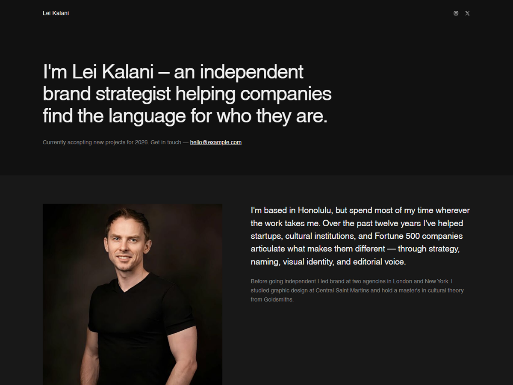

# Lei

  

Elegant dark personal portfolio theme for creative directors, consultants, and professionals. Deep black background, light editorial typography, generous whitespace. Full Site Editing, 5 starter patterns, no code required.

- **WordPress.org:** https://wordpress.org/themes/lei/
- **Live preview:** https://wp-themes.com/lei/

## Description

Lei is a free, lightweight WordPress block theme for creative professionals, consultants, and personal brands. Built for the Site Editor with Full Site Editing support, it works out of the box for creative directors, fashion professionals, writers, photographers, and anyone who needs a refined online presence.

The theme ships with 5 ready-made block patterns: hero statement, about section with portrait, expertise overview, selected work gallery, and a minimal footer with contact CTA. Every element is customizable through the WordPress Site Editor — no coding required.

**Key features:**

* Deep black background with elegant light typography and generous whitespace
* Dark and light style variations
* Fully responsive design optimized for mobile, tablet, and desktop
* 5 starter patterns for one-page portfolio or multi-page personal site
* Editorial design inspired by fashion and creative industry aesthetics
* Sticky footer that stays at the bottom on short pages
* Fast and minimal — no JavaScript, no frameworks, no dependencies
* SEO-friendly semantic HTML with proper heading hierarchy
* GPLv2 licensed, free forever

## Installation

1. In your WordPress admin panel, go to Appearance > Themes and click "Add New".
2. Click "Upload Theme" and choose the lei.zip file.
3. Click "Install Now" and then "Activate".
4. Go to Settings > General and set your site title to your desired name.
5. Navigate to Appearance > Editor to customize the theme using the Site Editor.

To install the development version from this repository, download it as a ZIP (Code > Download ZIP), rename the folder inside to `lei` and upload it in Appearance > Themes > Add New Theme > Upload Theme.

## Requirements

- WordPress 6.6 or later
- Tested up to WordPress 7.1
- PHP 7.4 or later

## Changelog and credits

The full changelog, image and font credits with their licenses are listed in [readme.txt](readme.txt).

## License

Lei is distributed under the terms of the [GNU General Public License v2 or later](https://www.gnu.org/licenses/gpl-2.0.html).

---

More themes by Roman Fink: https://wordpress.org/themes/author/romanfink/
